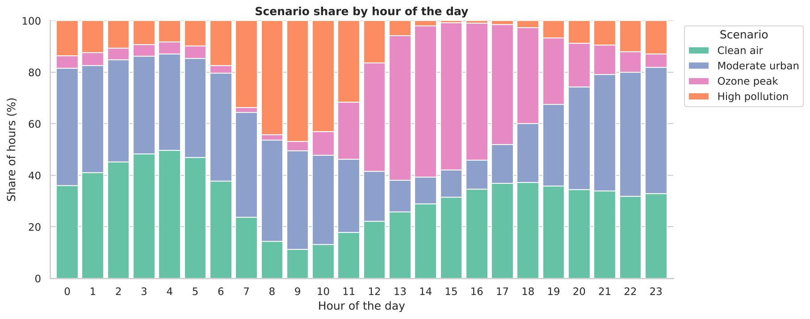

# Calidad del aire en la CDMX: clustering de escenarios y pronóstico a una hora

[English](README.md) | **Español**

Proyecto de ciencia de datos de principio a fin con seis años de datos horarios de contaminación
de la red de monitoreo de la Ciudad de México (SEDEMA). Con aprendizaje no supervisado se
identifican cuatro **escenarios atmosféricos** recurrentes, y una red **LSTM** pronostica en qué
escenario estará cada estación durante la siguiente hora.



## Puntos clave

- **Ingeniería de datos:** une 54 archivos de Excel (9 contaminantes × 6 años × 36 estaciones) en
  una sola tabla de 1.9 millones de registros estación-hora, con capping de outliers e imputación
  en dos pasos (interpolación por estación + MICE).
- **Aprendizaje no supervisado:** comparación de K-Means y Gaussian Mixture (codo, BIC, silueta),
  con cuatro escenarios interpretables: *Aire limpio*, *Urbano moderado*, *Pico de ozono* y
  *Contaminación alta*.
- **Pronóstico de series de tiempo:** LSTM apilada sobre ventanas de 24 horas, evaluada en un año
  completo que el modelo nunca vio, contra baselines de persistencia y regresión logística.
- **Evaluación correcta:** división temporal en train / validación / test (2020–23 / 2024 / 2025);
  cada paso de preprocesamiento se ajusta solo con el periodo de entrenamiento.
- **Buenas prácticas:** paquete reutilizable en `src/`, pruebas unitarias, linter y CI con
  GitHub Actions.

## Resultados

**Escenarios (2025, notebook 01)**

| Escenario | % de horas | Cuándo ocurre |
|---|---|---|
| Aire limpio | 32% | Madrugada, temporada de lluvias (jun–sep), domingos |
| Urbano moderado | 32% | Tardes-noche y noches |
| Pico de ozono | 20% | 13–16 h, temporada seca-cálida (mar–may) |
| Contaminación alta | 15% | Hora pico de la mañana (8–10 h), nov–dic |

**Pronóstico de la siguiente hora (año de prueba 2025, notebook 02)**

| Modelo | Exactitud | F1 macro |
|---|---|---|
| Clase mayoritaria | 0.341 | 0.127 |
| Persistencia (mismo escenario que ahora) | 0.758 | 0.759 |
| Regresión logística, última hora | 0.768 | 0.771 |
| **LSTM, ventana de 24 horas** | **0.783** | **0.787** |
| Regresión logística, ventana de 24 horas | 0.791 | 0.795 |

La LSTM supera a la persistencia por 2.8 puntos de F1 macro y anticipa el 38% de las horas en
las que cambia el escenario. Una regresión logística con la misma ventana de 24 horas queda
ligeramente arriba (0.795): con estas variables la capacidad extra de la LSTM no se traduce en
mejor desempeño, y el modelo más simple sería la mejor opción en producción. El notebook 02
explica por qué y qué probar después.

Los notebooks, el código y las gráficas están en inglés.

## Datos

Concentraciones horarias de CO, NO, NO2, NOx, O3, PM10, PM2.5, PMCO y SO2 del Sistema de
Monitoreo Atmosférico (SIMAT), publicadas por la Secretaría del Medio Ambiente (SEDEMA). Se usan
las 7 estaciones que miden todos los contaminantes con cobertura aceptable (AJM, CAM, MER, NEZ,
PED, TLA, UIZ). Los archivos no se incluyen en el repositorio; las instrucciones de descarga están
en [`data/README.md`](data/README.md).

## Cómo ejecutarlo

```bash
git clone https://github.com/lezti02/cdmx-air-quality.git
cd cdmx-air-quality
python -m venv .venv && source .venv/bin/activate   # Windows: .venv\Scripts\activate
pip install -r requirements.txt
# Descarga los archivos de SEDEMA en data/raw/ (ver data/README.md)
jupyter lab notebooks/
```

## Licencia

[MIT](LICENSE)
