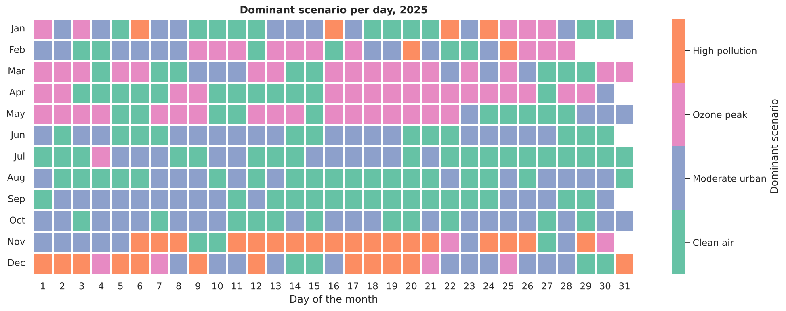
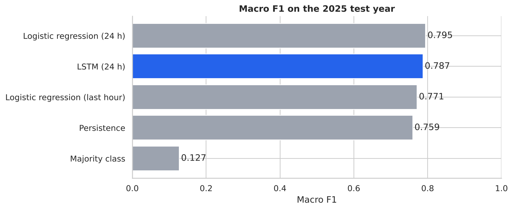

# Mexico City Air Quality: Scenario Clustering and Next-Hour Forecasting

**English** | [Español](README.es.md)

End-to-end data science project on six years of hourly air pollution data from Mexico City's
monitoring network (SEDEMA). Unsupervised learning finds four recurring **atmospheric
scenarios**, and an **LSTM** network forecasts which scenario each station will be in during the
next hour.


## Motivation

This project started from a personal question: how polluted is the air in Mexico City, and how do
pollution levels move across neighbourhoods and over time? Air pollution is a direct health risk
and a central topic of environmental policy. The project is built in two steps towards an
**early-warning system**: first understand and group the city's atmospheric conditions
(clustering), then anticipate them before they happen (forecasting).

## Highlights

- **Data engineering:** merges 54 raw Excel files (9 pollutants × 6 years × 36 stations) into one
  tidy table of 1.9 million station-hours, with outlier capping and a two-step imputation
  (per-station interpolation + MICE).
- **Unsupervised learning:** K-Means vs. Gaussian Mixture model selection (elbow, BIC,
  silhouette), with four interpretable scenarios: *Clean air*, *Moderate urban*, *Ozone peak* and
  *High pollution*.
- **Time-series forecasting:** stacked LSTM on 24-hour windows, evaluated on a held-out year
  against persistence and logistic-regression baselines.
- **Sound evaluation:** time-based train / validation / test split (2020–23 / 2024 / 2025), with
  every preprocessing step fitted on the training period only.
- **Engineering practices:** reusable `src/` package, unit tests, linting and GitHub Actions CI.

## Key results

**Scenarios (2025, notebook 01)**

| Scenario | Share of hours | When it happens |
|---|---|---|
| Clean air | 32% | Before dawn, rainy season (Jun–Sep), Sundays |
| Moderate urban | 32% | Evenings and nights |
| Ozone peak | 20% | 1–4 p.m., warm dry season (Mar–May) |
| High pollution | 15% | Morning rush hour (8–10 a.m.), Nov–Dec |



**Forecasting the next hour (test year 2025, notebook 02)**

| Model | Accuracy | Macro F1 |
|---|---|---|
| Majority class | 0.341 | 0.127 |
| Persistence (same scenario as now) | 0.758 | 0.759 |
| Logistic regression, last hour | 0.768 | 0.771 |
| **LSTM, 24-hour window** | **0.783** | **0.787** |
| Logistic regression, 24-hour window | 0.791 | 0.795 |

The LSTM beats persistence by 2.8 points of macro F1 and anticipates 38% of the hours in which
the scenario changes. A logistic regression on the same 24-hour window does slightly better
(0.795), so with these features the extra capacity of the LSTM does not pay off, and the simpler
model would be the better production choice. Notebook 02 discusses why and what to try next.



## Data

Hourly concentrations of CO, NO, NO2, NOx, O3, PM10, PM2.5, PMCO and SO2 from Mexico City's
Automatic Atmospheric Monitoring Network (RAMA), published by the Environment Department
(SEDEMA). The analysis keeps the 7 stations that measure every pollutant with acceptable
coverage, spread across the city:

| Code | Station | Area | Profile (2025) |
|---|---|---|---|
| AJM | Ajusco Medio | South | ~51% clean air, ~3% high pollution |
| PED | Pedregal | South-west | ~51% clean air, ~5% high pollution |
| MER | Merced | City centre | ~24% high pollution |
| TLA | Tlalnepantla | North (industrial) | ~23% high pollution |
| CAM | Camarones | North | ~20% high pollution |
| UIZ | UAM Iztapalapa | East | ~17% high pollution |
| NEZ | Nezahualcóyotl | East | ~13% high pollution |

The raw files are not included in the repository. See [`data/README.md`](data/README.md) for
download instructions and the expected file layout.

## Methodology

1. **Merging.** Each file is one pollutant-year in wide format (one column per station). Files are
   reshaped to one row per station-hour and merged; `-99` codes become missing values.
2. **Data quality.** Stations with poor coverage are dropped. Outliers are kept but capped at
   Q3 + 1.5 × IQR, because extreme hours are real and important. Short gaps (≤ 3 h) are filled by
   linear interpolation within each station; longer gaps by MICE (`IterativeImputer`).
3. **Clustering (notebook 01).** Standardized pollutants, PCA for visualization, K-Means vs. GMM
   for k = 2…8. k = 4 is chosen for interpretability. Scenarios are named from the centroids,
   not from arbitrary cluster numbers, so the labels are reproducible.
4. **Profiling.** Scenario share by hour, weekday, month and station; daily calendar;
   hour-to-hour transition matrix.
5. **Time-series EDA (notebook 02).** Ozone trend and seasonality (including the 2020 lockdown),
   and autocorrelation to choose a 24-hour input window.
6. **Forecasting.** K-Means labels each hour; a stacked LSTM (128 → 64 units, batch
   normalization, dropout, class weights, early stopping on the validation year) predicts the
   scenario at t + 1.

## Project structure

```
├── notebooks/
│   ├── 01_clustering_2025.ipynb              # Data quality, EDA, clustering and profiling (2025)
│   └── 02_lstm_forecasting_2020_2025.ipynb   # Time-series EDA, baselines and LSTM (2020–2025)
├── src/cdmx_air/                             # Reusable code used by both notebooks
│   ├── config.py                             # Pollutants, stations, paths
│   ├── data.py                               # Loading and reshaping SEDEMA files
│   ├── cleaning.py                           # Quality reports, capping, imputation
│   ├── clustering.py                         # Model selection, scenario naming, transitions
│   ├── sequences.py                          # Sliding windows for the LSTM
│   └── plots.py                              # Shared plotting style
├── tests/                                    # Unit tests (pytest)
├── data/                                     # Raw data goes here (not versioned)
├── reports/figures/                          # Figures exported by the notebooks
├── requirements.txt
└── pyproject.toml
```

## How to run

```bash
git clone https://github.com/lezti02/cdmx-air-quality.git
cd cdmx-air-quality
python -m venv .venv && source .venv/bin/activate   # Windows: .venv\Scripts\activate
pip install -r requirements.txt
# Download the SEDEMA files into data/raw/ (see data/README.md)
jupyter lab notebooks/
```

Notebook 01 runs in about 2 minutes. Notebook 02 trains the LSTM on CPU in about 20–25 minutes.

Run the tests and the linter with:

```bash
pip install pytest ruff
pytest
ruff check src tests
```

## Potential applications

- **Targeted alerts:** knowing which areas and hours are most exposed lets health and emergency
  services act locally instead of city-wide.
- **Localized policy:** protecting green areas in the south; stricter traffic and industrial
  measures in the centre and north.
- **Operational pipeline:** connected to RAMA's hourly feed, the cleaning steps, K-Means and the
  forecaster could classify and anticipate scenarios in real time, feed a dashboard by station,
  and be monitored for data drift with scheduled retraining.

## Limitations and next steps

- Multi-step forecasting (6, 12 or 24 hours ahead) is what an early-warning system needs and is the
  natural next step.
- Meteorological variables (temperature, wind, solar radiation, humidity) are not used yet and
  would likely improve both the clustering and the forecast.
- The scenario labels come from K-Means, so the forecast predicts a data-driven category, not the
  official air-quality index. A natural next step is to forecast pollutant concentrations
  directly, or the official index.
- Only 7 of the 36 stations have enough coverage for this analysis; covering the whole
  metropolitan area would need a strategy for stations that do not measure every pollutant.

## Tech stack

Python · pandas · NumPy · scikit-learn · TensorFlow / Keras · statsmodels · Matplotlib ·
seaborn · Jupyter · pytest · GitHub Actions

## License

[MIT](LICENSE)
